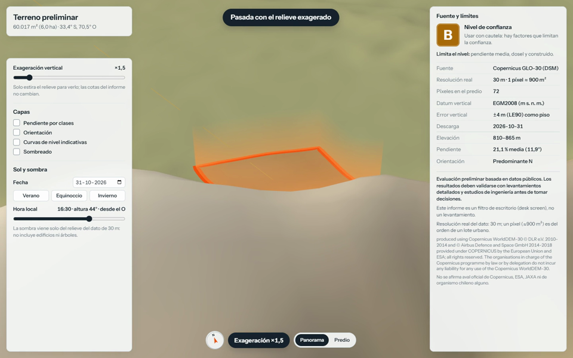
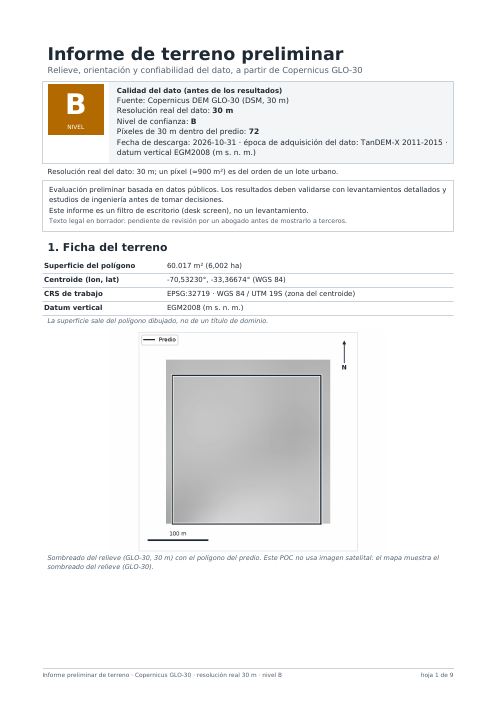

# informe-terreno-rm

Informe automático de terreno a partir de datos públicos de elevación. Se dibuja un polígono en la Región Metropolitana de Santiago y el pipeline entrega, sin intervención manual:

- un **PDF de 14 secciones** (elevación, pendiente por clases, orientación, asoleamiento y sombra por relieve, perfiles, curvas indicativas, contexto hídrico, comparación de fuentes y anexo de trazabilidad);
- un **modelo 3D** (`.glb`) y un **visor web** con capas, exageración vertical y simulación de sol por fecha y hora;
- un **video** de 45 segundos del terreno;
- un **nivel de confianza A/B/C** que dice, con números, qué tan confiable es el dato para ese lote en particular.



El principio de diseño es la honestidad del dato: con un modelo de 30 m, un píxel ocupa lo mismo que un lote urbano. El informe prefiere decir "no concluyente" antes que dar un número falso, y cada valor se puede rastrear hasta su dataset, versión y fecha.

## Qué se midió

El POC se validó en 24 lotes de prueba de la RM (planos, intermedios y de cerro), elegidos con una regla reproducible y solo con datos públicos.

- **Error del modelo de elevación Copernicus GLO-30 en Santiago:** RMSE de 1,3 a 1,5 m dentro del lote contra nubes de puntos Pléiades de 5 m, y de 2,5 a 3,2 m en terreno plano y de 5 a 10,6 m en ladera contra las huellas de los satélites láser ICESat-2 y GEDI.
- **El sello de confianza del dato ordena el error real:** error medio de 1,98 m en los sitios A, 5,40 m en los B y 7,58 m en los C (correlación de Spearman 0,73). La regla de evaluación se escribió antes de correr los sitios.
- **El dosel pesa menos de lo que parecía:** con 4.421 huellas ICESat-2/GEDI, árboles y edificios suman de 0,5 a 1,6 m de error y solo en terreno plano; la pendiente pesa mucho más.
- **Reproducible:** dos corridas del mismo sitio dan el mismo hash; un informe tarda unos 20 s con los datos en caché.
- **Más de 470 tests** automatizados (pytest) y pruebas del visor con Playwright.

El detalle está en [`docs/validacion-tecnica.md`](docs/validacion-tecnica.md) y en [`docs/auditoria/`](docs/auditoria/).

## Ejemplo

[`ejemplo/rm04_piedemonte_alto/`](ejemplo/rm04_piedemonte_alto/): un lote de 6 ha en el piedemonte, con nivel B (lo limitan la pendiente media y el dosel). Incluye el [PDF](ejemplo/rm04_piedemonte_alto/report.pdf), el modelo [GLB](ejemplo/rm04_piedemonte_alto/terreno.glb), el [video](ejemplo/rm04_piedemonte_alto/video.mp4) y el manifiesto con todas las fuentes y hashes.



## Cómo funciona

```
polígono ──► descarga DEM (GLO-30 desde AWS, AW3D30 desde OpenTopography)
         ──► reproyección y recorte (GDAL, UTM 19S)
         ──► pendiente, orientación, sombreado, curvas, horizonte solar
         ──► comparación de fuentes + ICESat-2/GEDI + ESA WorldCover
         ──► regla A/B/C (data/confidence_rules.json)
         ──► PDF + GLB + visor three.js + video
```

| Carpeta | Contenido |
|---|---|
| `terreno/` | El pipeline: descarga, reproyección, análisis de terreno, confianza, informe, 3D y video |
| `terreno/agent*.py` | Capa opcional de agente (Claude Agent SDK) con 10 herramientas sobre el pipeline |
| `viewer/` | Visor web (three.js) y sus pruebas Playwright |
| `tools/` | Selección reproducible de sitios, barrido de catálogos y análisis de dosel vs error |
| `data/` | Lotes de prueba y reglas de confianza versionadas |
| `tests/` | Pruebas unitarias y de integración |
| `docs/` | Validación técnica, auditorías, especificación y términos de cada fuente |

## Uso

Requiere Python 3.14, GDAL en la línea de comandos y Node.js para el visor y el video.

```bash
python -m venv .venv
.venv/Scripts/pip install -r requirements.lock   # en Linux/macOS: .venv/bin/pip
python -m pytest                                  # pruebas sin red
python run_pilots.py                              # los 8 lotes piloto, solo GLO-30
python run_pilots.py --live --video               # con AW3D30, ICESat-2/GEDI y video
```

`--live` necesita una API key gratuita de OpenTopography (`OPENTOPOGRAPHY_API_KEY`) y una cuenta de NASA Earthdata (`~/_netrc` o `EARTHDATA_USERNAME`/`EARTHDATA_PASSWORD`). El script solo verifica que existan y nunca las imprime ni las guarda.

## Estado

Prueba de concepto cerrada en noviembre de 2026. Lo que quedó abierto está en la sección 7 de la [validación técnica](docs/validacion-tecnica.md): cómo combinar los dos sellos en un nivel final, la revisión legal de las licencias comerciales y la prueba con lectores no expertos.

## Datos y atribución

- Copernicus GLO-30: *produced using Copernicus WorldDEM-30 © DLR e.V. 2010-2014 and © Airbus Defence and Space GmbH 2014-2018 provided under COPERNICUS by the European Union and ESA; all rights reserved.*
- AW3D30 © JAXA. ICESat-2 ATL08 (NSIDC) y GEDI L2A (NASA LP DAAC / ORNL DAAC) vía NASA Earthdata.
- ESA WorldCover 10 m 2021 © ESA, CC BY 4.0.
- Pléiades y SPOT (OpenTopography) se usaron solo como referencia interna para medir el error; no se redistribuyen y no aparecen en ningún informe.
- Capas vectoriales en [`datos_publicos/FUENTES.md`](datos_publicos/FUENTES.md). División político-administrativa: autorizada su circulación por Resolución N° 87 del 2023 de la Dirección Nacional de Fronteras y Límites del Estado. © colaboradores de OpenStreetMap (ODbL).

## Licencia

El código es MIT ([LICENSE](LICENSE)). Los datos de terceros mantienen sus propias licencias, listadas en [`docs/licencias/`](docs/licencias/).
